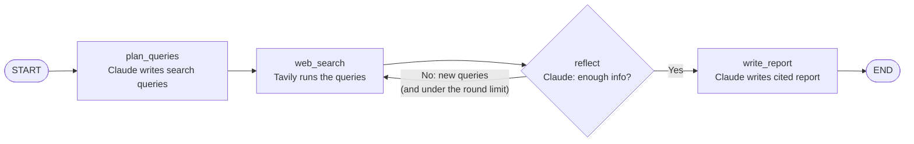

# 🔎 Web Research Agent

An AI agent that **researches any question on the web and writes a cited report**, built with **LangGraph**, **Tavily** (search) and **Claude** (reasoning and writing).

You ask a question. The agent plans its searches, reads the results, decides whether it knows enough, searches again if it doesn't, and then writes a structured Markdown report where every fact links back to a source.

```text
$ python main.py "What is the Model Context Protocol and who supports it?"

🧭 Planned searches:
   - Model Context Protocol MCP explained
   - companies and tools supporting Model Context Protocol
   - MCP vs function calling differences
🔎 Search round 1: found 12 results
🤔 Need more info, follow-up searches:
   - MCP adoption IDEs 2026
🔎 Search round 2: found 4 results
✅ Enough information gathered
================================================================
The Model Context Protocol (MCP) is an open standard ... [1][3]
```

---

## ✨ Features

- **Plans before searching**: Claude splits your question into focused search queries
- **Self-reflection loop**: after each search round, the agent checks what's missing and searches again (up to a limit you set)
- **Cited answers**: every claim is tagged `[1]`, `[2]`... with a source list at the end
- **Two interfaces**: a command-line tool and a Streamlit web app
- **Live progress**: you see each step of the agent as it runs

---

## 🧠 How it works

The agent is a **graph** (a LangGraph `StateGraph`). Each box is a Python function (a *node*). They all read and update one shared **state** dictionary.



| Step | Node | What happens |
|------|------|--------------|
| 1 | `plan_queries` | Claude turns your question into 2-4 search queries. It uses **structured output**: Claude must reply in an exact Pydantic shape (`SearchPlan`), so the code gets a clean Python list. |
| 2 | `web_search` | Each query goes to the Tavily Search API. The results (title, URL, text snippet) are **appended** to `state["sources"]`. |
| 3 | `reflect` | Claude reviews the sources and returns a `Reflection`: is the info sufficient? If not, what follow-up queries would fill the gaps? |
| 4 | *conditional edge* | `should_continue()` loops back to `web_search` if there are follow-up queries **and** the round limit isn't reached. Otherwise it moves on. |
| 5 | `write_report` | Claude writes the final report using **only** the numbered sources. The code adds the reference list, so the URLs are always real. |

### Key concepts (useful when explaining this project to others)

- **State**: a `TypedDict` that flows through the graph. `sources` is declared as `Annotated[list, operator.add]`, which tells LangGraph to **append** new results instead of overwriting them. That's how results pile up across search rounds.
- **Nodes**: plain functions `state -> partial update`. Each node returns only the keys it changes.
- **Conditional edges**: these let the graph branch and **loop**. This is what makes it an *agent* and not a fixed pipeline: the model decides the path at runtime.
- **Structured output**: `llm.with_structured_output(PydanticModel)` makes Claude return validated data instead of free text. This is reliable glue between the LLM and your code.
- **Grounding & citations**: the writer can only use the numbered sources. This reduces hallucinations and makes every claim checkable.
- **Safety limit**: `max_iterations` stops the loop so the agent can't search forever (or burn through your API credits).

---

## 🚀 Getting started

### 1. Prerequisites

- Python **3.10+**
- An **Anthropic API key**: [console.anthropic.com](https://console.anthropic.com)
- A **Tavily API key** (free tier available): [app.tavily.com](https://app.tavily.com)

### 2. Install

```bash
git clone https://github.com/Shadab995/web-research-agent.git
cd web-research-agent

python -m venv .venv
source .venv/bin/activate        # Windows: .venv\Scripts\activate

pip install -r requirements.txt
```

### 3. Configure your keys

```bash
cp .env.example .env             # Windows: copy .env.example .env
```

Then open `.env` and paste your keys.

### 4. Run it

**Command line:**

```bash
python main.py "What are the latest advances in solid-state batteries?"

# more search rounds, save the report
python main.py "Compare LangGraph, CrewAI and AutoGen" --max-iterations 3 --save report.md
```

**Web app:**

```bash
streamlit run app.py
```

Then open http://localhost:8501.

**From your own Python code:**

```python
from research_agent import build_graph, initial_state

app = build_graph()
result = app.invoke(initial_state("Who won the 2026 FIFA World Cup?"))
print(result["report"])
```

---

## 📁 Project structure

```text
web-research-agent/
├── research_agent.py   # The agent: state, nodes, graph (start reading here)
├── main.py             # Command-line interface with live progress
├── app.py              # Streamlit web interface
├── requirements.txt    # Python dependencies
├── .env.example        # Template for your API keys
└── README.md
```

---

## ⚙️ Configuration

| Setting | Where | Default | Notes |
|---------|-------|---------|-------|
| `CLAUDE_MODEL` | `.env` or `--model` | `claude-haiku-5-5` | A bigger model (e.g. `claude-sonnet-5-5`) writes better reports but costs more |
| `max_iterations` | `--max-iterations` / sidebar | `2` | Max number of search rounds |
| `results_per_query` | `build_graph()` / sidebar | `4` | Tavily results per query |

**Cost:** a typical run makes 3-4 Claude calls and uses about 10-30k tokens, plus 3-8 Tavily searches.

---

## 🛠️ Ideas to extend it

- Add a **human-in-the-loop** step to approve the search plan (LangGraph `interrupt`)
- Fetch **full page content** for the best sources instead of only snippets
- Add **memory** (a LangGraph checkpointer) so you can ask follow-up questions
- Run the searches **in parallel** with LangGraph's `Send` API
- Export the report to **PDF**

---

## 📚 Learn more

- [LangGraph docs](https://langchain-ai.github.io/langgraph/)
- [Tavily docs](https://docs.tavily.com/)
- [Claude API docs](https://docs.claude.com/)

## 📄 License

MIT. See [LICENSE](LICENSE).
